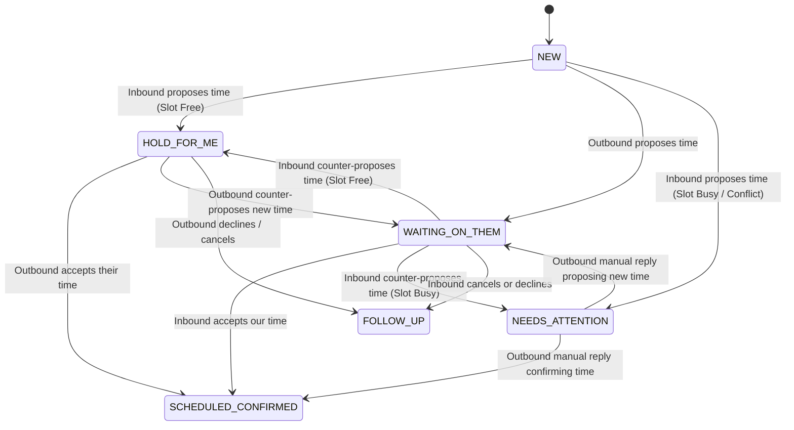

# EmailAgent: Local Multi-Agent Email Triage & Scheduling System

An intelligent, privacy-preserving email triage and scheduling system running locally with a lightweight open-source LLM (`Qwen2.5-0.5B/0.8B`), LangGraph, and Google Workspace APIs (Gmail, Google Calendar, Google Sheets).

---

## 1. System Vision & Core Philosophy

Instead of feeding large, multi-message email threads to a small language model and hoping for reliable arithmetic and scheduling, this system is architected around **State + Delta = New State**:

1. **Person-Centric CRM (Not an Inbox Log)**: Google Sheets maintains **one row per human**, tracking their full relationship lifecycle, touchpoint notes, and calendar history.
2. **Deterministic Veto Power**: The small local LLM acts strictly as an **Intent & Entity Classifier**; deterministic Python code handles calendar free/busy conflict checking, date calculations, and state transitions.
3. **Trigger-Agnostic Engine**: The core pipeline processes message events independently of whether they are invoked by offline test runners, local interval polling, or Google Cloud Pub/Sub push notifications.

---

## 2. The Person-Centric CRM Specification

The Google Sheets CRM maintains a unified view of relationships rather than an append-only log of emails.

### Sheet Column Layout

| Col | Header | Description | Example |
| :--- | :--- | :--- | :--- |
| **A** | **Name** | Full contact name | `Sarah Jenkins` |
| **B** | **Primary Email** | Unique primary lookup key | `sarah.jenkins@acmepartners.com` |
| **C** | **Secondary Emails** | Comma-separated alias emails | `sjenkins@gmail.com, sarah@personal.me` |
| **D** | **Status** | Current lifecycle state enum | `hold for me` |
| **E** | **Last Contacted** | ISO date of latest touchpoint | `2026-10-29` |
| **F** | **Events (In-line)** | Chronological calendar touchpoints | `• 2026-11-03 14:00 PST: [HOLD] Intro Call` |
| **G** | **Notes / History** | Append-only multiline history log | `[10/29]: Inbound partnership inquiry; proposed 11/3` |
| **H** | **Processed Msg IDs**| Idempotency audit record | `msg_001, msg_004, sent_012` |

---

## 3. The Scheduling "Ping-Pong" Finite State Machine (FSM)

Meeting scheduling is an asynchronous negotiation between **Inbound** and **Outbound** messages.

### State Transitions



### Transition Matrix

| Direction | Current Status | Message Intent | Calendar Condition | Resulting Status | Calendar Action |
| :--- | :--- | :--- | :--- | :--- | :--- |
| **Inbound** | `NEW` | Propose time | Slot Free | `hold for me` | Create `[HOLD]` event |
| **Inbound** | `NEW` | Propose time | **Slot Busy** | `needs attention` | Log conflict note; no event |
| **Inbound** | `wait for them` | Accept our time | N/A | `scheduled an appointment` | Upgrade `[HOLD]` → `[CONFIRMED]` |
| **Inbound** | `wait for them` | Counter-propose | Slot Free | `hold for me` | Reschedule `[HOLD]` to new time |
| **Inbound** | `wait for them` | Counter-propose | **Slot Busy** | `needs attention` | Log conflict note; leave hold |
| **Outbound** | `hold for me` | Accept their time | N/A | `scheduled an appointment` | Upgrade `[HOLD]` → `[CONFIRMED]` |
| **Outbound** | `hold for me` | Counter-propose | N/A | `wait for them` | Reschedule `[HOLD]` to new time |
| **Any** | `needs attention`| Outbound reply | Propose new | `wait for them` | Create/Shift `[HOLD]` |
| **Any** | Any | Cancel / Decline | N/A | `follow up` | Delete/Strike `[HOLD]` event |
| **Any** | Any | Ambiguous text | N/A | `needs attention` | Flag for human review |

---

## 4. Niche Procedures & Edge-Case Architecture

### 1. The 3-Layer Zero-Duplicate Guarantee (Idempotency)
To prevent duplicate calendar invites or duplicate CRM entries when re-running:
1. **Gmail Layer**: Processed inbound emails are stripped of `UNREAD` and stamped with the label `AI-Triaged`. Filter query: `is:unread category:primary -label:AI-Triaged`.
2. **Calendar Layer**: Every event created stores the initiating Gmail message ID in private extended properties:
   ```json
   {
     "extendedProperties": {
       "private": { "source_message_id": "msg_001" }
     }
   }
   ```
   Before insertion, Google Calendar is searched via `privateExtendedProperty='source_message_id=msg_001'`. If found, existing event is updated rather than re-created.
3. **Sheets Layer**: Column H (`Processed Msg IDs`) maintains a comma-separated list of all message IDs incorporated into that contact's history. Re-evaluations are skipped.

### 2. Scoped Outbound Sent Mail Monitoring
To track when the user replies without spying on personal emails:
- The agent **only** queries `in:sent` for messages where `to:` matches an email already present in Column B or C of the CRM.
- Processed sent emails are recorded in Column H (`Processed Msg IDs`), preventing duplicate processing.

### 3. Primary vs. Secondary Contacts
- Each CRM row has one **Primary Email** (Column B) representing the canonical contact.
- Secondary contacts or aliases can be added to Column C (`Secondary Emails`).
- When an email arrives from any secondary address, it routes to the primary person's row and updates their history.

### 4. Deterministic Free/Busy Veto
The small local LLM is never tasked with checking calendar availability:
1. LLM extracts candidate timestamp (assumed `America/Los_Angeles` / PST default).
2. Python executes `service.freebusy().query()` on Google Calendar.
3. If occupied: Python overrides state transition to `needs attention`, leaves calendar unchanged, and logs a conflict warning to the CRM notes cell.

### 5. Escaping `needs attention`
- `needs attention` serves as the circuit breaker for conflicts and model uncertainty.
- The human escapes this state simply by replying: when the agent detects an **Outbound** message to that contact proposing a new time or confirming an alternative, it automatically flips status back to `wait for them` or `scheduled an appointment`.

---

## 5. System Execution Pipeline

```text
[ Trigger: CLI / Cron / Pub/Sub ]
               │
               ▼
   [ 1. Ingestion & Scoping ]
   - Inbound: is:unread category:primary -label:AI-Triaged
   - Outbound: in:sent to:CRM_CONTACTS (unprocessed)
               │
               ▼
   [ 2. Context Retrieval ]
   - Look up Contact row in Google Sheets CRM
   - Look up Active Upcoming Event (> now) in Google Calendar
               │
               ▼
   [ 3. Cognitive Classifier (Qwen Local LLM) ]
   - Input: Contact State + Active Event + New Email Body
   - Output: 5-way Intent + Candidate Timestamp + Clean Summary
               │
               ▼
   [ 4. Deterministic Decision Engine (Python) ]
   - If Proposing Time: Check Google Calendar Free/Busy
   - Apply FSM State Transition Matrix
               │
               ▼
   [ 5. Workspace Actions ]
   - Google Calendar: Create/Update/Delete [HOLD] or [CONFIRMED]
   - Google Sheets: Update Status, append in-line Notes & Events
   - Gmail: Apply 'AI-Triaged' label, mark read
```

---

## 6. Implementation & Testing Roadmap

- [x] **Milestone 0: Security & Contracts**: Update `.gitignore`, establish `schemas.py`, create test fixture `mock_emails.json`.
- [x] **Milestone 1: Architectural Specification**: Document full FSM ping-pong flow, CRM layout, and idempotency in `README.md`.
- [ ] **Milestone 2: Offline Intent Classifier Evaluation**: Benchmark local Qwen model on `mock_emails.json` against the 5-way intent taxonomy.
- [ ] **Milestone 3: Deterministic State Machine Unit Tests**: Validate FSM transitions and conflict routing with pure Python tests.
- [ ] **Milestone 4: Google Workspace Services**: Implement idempotent `SheetsCRMService` and `CalendarService`.
- [ ] **Milestone 5: End-to-End Pipeline**: Wire ingestion, agent reasoning, and workspace execution.
